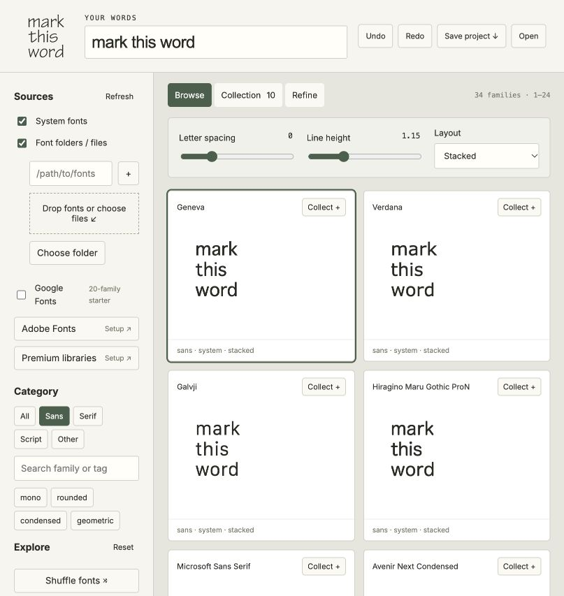

# logotyper

**the v1 of your wordmark 9000x faster**

A local typography workbench: type a name, browse it in real fonts, collect promising directions, then refine and export vector outlines. The supplied logotyper SVG anchors a classic Mac interface with neutral gray panels, black controls, etched groups and compact pixel labels. User source fonts are never bundled.



## Run locally

Requires **macOS, Node 22+, and Xcode Command Line Tools (Swift)**. No npm runtime dependencies or model API key required.

```sh
git clone --branch main https://github.com/AlexBloom/logotyper.git
cd logotyper
npm ci
npm run build
npm start
```

Open **http://127.0.0.1:9000**. Use `node bin/wordmark.mjs serve --port 9010` for a different port. `npm run build` compiles both native engines; otherwise they compile on demand. Windows/Linux rendering is not supported.

## Browse → collect → refine

1. **Browse:** enter your words in the left sidebar’s multiline text area. **Use returns** respects Enter/Shift+Enter and blank lines; **One line** flattens the preview while retaining your typed breaks. Sidebar sections collapse and remember their state. Enable system fonts, add multiple local directories, drop font files/folders, or enable the Google Fonts starter catalog. Choose sans, serif, script, other, tags, or family search. Shuffle uses a repeatable seed; Reset restores the initial exploration settings.
2. **Collect:** save independent snapshots. Freeze a collection into a next round, return to its parent, or generate ten stepped spacing variations of a selected design. The current round responds to global settings; parent rounds stay unchanged.
3. **Refine:** choose horizontal, stacked, offset, or initials + name layouts. Adjust tracking and line height, mix fonts per word, drag elements, rotate words/letters, outline text, split words into individual letterforms, duplicate/remove elements, and add typed symbols. Undo/redo and project JSON keep versions recoverable.
4. **Export:** generate outlined SVG, a 2000 × 1300 PNG, and project JSON only when ready. Download SVG or use the Figma clipboard handoff; open it in local Illustrator. Export links clear after an edit so you cannot mistake an older export for the current design.

Previews use live browser type, not pre-rendered images. Only 24 cards are mounted per page; fonts load near the viewport with at most four concurrent requests. Typing and sliders update immediately from loaded fonts. Character-coverage discovery runs after a short typing pause. Font classification combines OS/2 metadata and source-name hints; uncertain families stay **Other**. Similarity is a transparent category/tag/weight/width ranking, not a learned visual embedding. Discovery currently chooses one face per family.

Project state autosaves in this browser; **Save project** creates a JSON backup. Reopening a project requires its font sources. Uploaded files remain under this app’s `.wordmark/uploads`; local paths in saved projects are not portable or suitable for public sharing without review. Legacy resource-only fonts need conversion first. Some legacy containers may outline successfully but lack a web-compatible preview; choose a converted OTF/TTF when needed.

Mobile layouts use a compact preview grid with **Fonts & filters** and **Selection & tools** panels. This is a loopback-only local app: opening it on a phone requires a separate deliberate sharing setup. No public network listener is enabled.

## Font providers

- **Local:** system fonts and multiple recursive directories; TTF, OTF, TTC, OTC, DFONT discovery. No global font installation.
- **Google Fonts:** a labelled 20-family starter catalog, downloaded on demand. Requires internet. No brand text is sent to Google. Export is enabled for compatible downloaded SFNT files; WOFF/WOFF2-only responses are preview-only. This is not the full Google catalog or a Google developer API account connection.
- **Adobe Fonts:** the setup panel explains the licensing requirement. Standard subscription embedding is not a general customer-driven font-authoring license. No account integration is claimed. See [Adobe’s web licensing terms](https://helpx.adobe.com/fonts/web/font-licensing/font-licensing.html).
- **Premium libraries:** [Monotype documents preview, search and similarity APIs](https://www.monotype.com/fonts-api), subject to commercial onboarding. The app exposes an information panel; a paid-library API adapter is not connected. User-licensed local files remain usable through folders.

## Optional agent help

Browse, shuffle, layout, collect, and iterate work without an agent. **Copy / download agent brief** gives any agent the current design and available font IDs. Import a proposed JSON settings patch, preview the change, and undo it. This is an explicit file handoff, not a hidden model call or credential connection. See [the agent API](docs/AGENT_API.md) for CLI, HTTP and MCP integration.

## Batch generation (compatible v1 workflow)

The compatible batch tool at `/batch.html` generates **10, 50, 100, or 250** lockups from one or several names. It is no longer linked from the main workspace. It preserves standalone HTML previews, SVGs, 1200 × 800 PNGs, rendered boards, CSV/JSON manifests, shortlisting and ZIP downloads. The existing `wordmark-generator` CLI and skill names continue to work; `mark-this-word` is also a binary alias.

## Command line

```sh
node bin/wordmark.mjs generate --name "Acme" --count 50 --out ./output/acme
node bin/wordmark.mjs generate --name "Acme" --name "Studio" --combine --count 100 --font-dir "/path/to/fonts" --out ./output/acme-studio
node bin/wordmark.mjs fonts --name "Acme" --font-dir "/path/to/fonts"
node bin/wordmark.mjs generate --request request.json --out ./output/new-exploration
node bin/wordmark.mjs serve --port 9100
```

The output directory must be new: previous results are never overwritten. Success writes JSON to stdout; errors use stderr and a nonzero exit code. `--stdin` accepts a JSON request on stdin.

```json
{
  "names": ["Acme", "Studio"],
  "combine": true,
  "count": 50,
  "seed": 9000,
  "fontDirectory": "/path/to/fonts",
  "excludeFamilies": []
}
```

Omit `fontDirectory` to use installed system fonts. `fontFiles` accepts explicit paths; `fonts` accepts IDs from font discovery. Names preserve spelling and case. Discovery checks glyph coverage and picks one face per family. If fewer families are available than requested lockups, the generator reuses families with different treatments; the manifest reports `uniqueFamilies`. A quantity is a count of lockups, **not a promise of that many unique fonts**. Seeds reproduce a run with the same font inventory and platform; other machines may render differently.

## Use as an agent skill

```sh
npm run install:skill
```

This installs a self-contained skill and runtime into `~/.codex/skills/wordmark-generator` (or `$CODEX_HOME/skills/wordmark-generator`). Existing installations are never overwritten. Restart or refresh your agent’s skill list, then invoke **`$wordmark-generator`**. To install for another agent that supports `SKILL.md` folders:

```sh
node scripts/install-skill.mjs /path/to/your/agent/skills/wordmark-generator
```

The same skill is available in `skills/wordmark-generator/`. Its bundled launcher works in the repository or in the installed skill. No dependence on this chat or a specific user’s folders.

## Agent interoperability

Batch entry points share the original request schema; live catalog and positioned-mark exports have separate documented contracts. See [the agent API](docs/AGENT_API.md) for JSON Schema, HTTP, MCP, and result contracts. See [AGENTS.md](AGENTS.md) for contributor instructions.

MCP client configuration (replace the path with your actual clone path):

```json
{
  "mcpServers": {
    "logotyper": {
      "command": "node",
      "args": ["/absolute/path/to/logotyper/bin/wordmark.mjs", "mcp"]
    }
  }
}
```

The server exposes `generate_wordmarks`, `list_fonts`, `catalog_fonts`, `compose_mark`, and `iterate_mark` over newline-delimited stdio JSON-RPC using the MCP `2024-11-05` initialization protocol. It does not configure an agent or grant permissions automatically. CLI/JSON and the HTTP API remain usable without MCP.

## Figma and Illustrator

**Figma:** Export a refined mark, then click **Send to Figma**. Download the selection SVG and drag it onto a Figma canvas. Copy SVG is also available; some design apps paste markup as text, so file import is the reliable route. This does not silently modify a remote Figma file.

For importing multiple individual SVGs, use the optional development plugin:

1. In Figma desktop, create a new development plugin to obtain your own Figma-assigned plugin ID.
2. Run `node scripts/configure-figma.mjs YOUR_PLUGIN_ID`.
3. Import the generated `figma-plugin/manifest.local.json` as a development plugin.
4. Run **Logotyper** in a design file and choose exported SVGs. The plugin imports vector paths and zooms to the results. It makes no network requests.

**Illustrator:** Export a refined mark, then click **Open in Illustrator**. The local server opens the SVG selection sheet with the installed Adobe Illustrator app. If Illustrator is missing or registered under another name, download the SVG and open it manually. Outputs are SVG files, not native `.ai` documents. Original fonts are not needed to view outlined artwork.

## GitHub workflow

In **Actions → wordmark generator → Run workflow**, enter a JSON array of names, choose a quantity, and optionally combine names. The macOS runner generates the lockups and uploads a seven-day artifact with the HTML, SVGs, PNGs, boards, and ZIP. It does not deploy a website.

Hosted runners have **their own system font inventory**, not your Mac’s fonts. For custom fonts, supply a repository-relative directory only if your font license permits storing and processing those fonts there. No fonts are included in this repository.

## Font licensing

**Users are responsible for their own font licensing.** Having a font installed, dropping a font into the app, or converting lettering to outlines does not grant a license or change its restrictions. Check the applicable terms for commercial use, logo creation, sharing, embedding, redistribution, and CI/cloud processing. Export archives do not contain source font files. The MIT license covers this software, not third-party fonts.

## Development

```sh
npm run build   # Compile the Swift renderer
npm run check   # Check JavaScript syntax
npm test        # Exercise all four scales, exports, uploads, HTTP and MCP
npm run dev     # Local web app
```

`engine/` renders typography and boards; `lib/` contains the shared runtime, HTTP and MCP entry points; `web/` is the local GUI; `skills/` contains the portable skill; `figma-plugin/` is the optional importer. `dev` is the development branch; `main` is protected and updated through a pull request. No production hosting is configured.

## Interface font and contrast

UI chrome uses [Geist Pixel Square](https://github.com/vercel/geist-font), published by Vercel under SIL OFL 1.1. The unmodified 28,540-byte WOFF2 is served locally, preloaded with `font-display: swap`, and accompanied by its license and pinned source in [web/fonts](web/fonts/). This UI font is separate from the font library used for wordmarks. No font framework, animation library, or external font service is needed for the interface.

The palette contains only black, white and neutral grays. Active controls use black/white; informational and secondary text retain or improve their previous contrast against each surface. See [the measured contrast audit](docs/contrast-audit.md). Live type previews, bounded card rendering and deferred outlined exports remain unchanged.

The public repository and package are now **logotyper**. The `logotyper` executable is primary; `wordmark-generator`, `mark-this-word`, the `$wordmark-generator` skill trigger, v2 project JSON and legacy batch commands remain compatible. Local browser saves migrate from the former project key when present.

Both desktop side panels have draggable dividers and header arrows to collapse them into compact rails. Widths and collapsed states persist in browser storage. Divider arrow keys resize (Shift for larger steps), Home/End use the supported limits, and Enter or double-click toggles collapse. Mobile retains the existing drawer controls. The workspace footer copy and batch-generator link have been removed.
